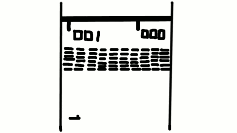

# 🎮 Breakout Game with Flask Web Portal

A classic retro **Breakout** arcade game built with Python's `turtle` graphics, integrated with a modern **Flask** web application featuring user authentication, gameplay showcases, and account management.



---

## 🌟 Features

### 🕹️ Arcade Gameplay (`breakout.py`)
- **Classic Breakout Mechanics**: Destroy 5 rows of 10 colored bricks (Red, Orange, Yellow, Green, Blue).
- **Physics & Bounce Logic**: Ball bounces off walls, paddle, and destroyed bricks.
- **Scoring & Lives**:
  - Earn **+10 points** for every brick destroyed.
  - Start with **5 lives**. Lose a life each time the ball slips past the paddle.
  - Dynamic score and lives HUD overlay.
- **Controls**:
  - `A` — Move paddle to the left
  - `D` — Move paddle to the right
- **Game Over Display**: Game ends when lives hit 0; click anywhere on the window to exit.

### 🌐 Web Portal (`main.py`)
- **User Authentication**: Secure user registration and login powered by `Flask-Login` and password hashing (`pbkdf2:sha256`).
- **Database**: SQLite database managed via `Flask-SQLAlchemy` storing registered users.
- **Responsive UI**: Styled with Bootstrap 5 and Jinja2 templates, featuring a hero landing page with animated gameplay gifs.
- **Game Launcher**: Authenticated users can launch the interactive desktop game directly from their web browser dashboard.

---

## 📁 Project Structure

```plaintext
Breakout_game/
├── static/
│   ├── breakout.gif           # Gameplay animation
│   └── start.gif              # Hero landing page background
├── templates/
│   ├── about.html             # About page template
│   ├── footer.html            # Common footer component
│   ├── game.html              # Authenticated user dashboard / launch pad
│   ├── header.html            # Navigation and navbar component
│   ├── index.html             # Landing page
│   ├── login.html             # User login form
│   ├── register.html          # User registration form
│   └── start.html             # Guest play prompt
├── app.py                     # App routing helper
├── breakout.py                # Standalone Turtle graphics Breakout engine
├── main.py                    # Flask application and database models
├── requirements_3.13.txt      # Dependency list
└── README.md                  # Project documentation
```

---

## 🚀 Getting Started

### Prerequisites

- **Python 3.10+** (Tested on Python 3.13.1)
- **Git**
- *Tkinter* (built-in standard library with most Python distributions for Turtle graphics)

### Installation

1. **Clone the repository** (if not already cloned):
   ```bash
   git clone https://github.com/deoishaan123-sketch/Breakout_game.git
   cd Breakout_game
   ```

2. **Create and activate a virtual environment**:
   - **Windows**:
     ```powershell
     python -m venv .venv
     .\.venv\Scripts\Activate.ps1
     ```
   - **macOS / Linux**:
     ```bash
     python3 -m venv .venv
     source .venv/bin/activate
     ```

3. **Install the dependencies**:
   ```bash
   pip install -r requirements_3.13.txt
   ```
   > **Note**: Ensure optional Flask form & login helpers are installed:
   > ```bash
   > pip install Flask-Login Flask-WTF bootstrap-flask Flask-CKEditor
   > ```

---

## 🎮 How to Play

### Option 1: Run via the Web Portal
1. Start the Flask server:
   ```bash
   python main.py
   ```
2. Open your web browser and navigate to:
   ```
   http://127.0.0.1:5000
   ```
3. Register an account or log in.
4. Click **Launch Breakout** to start the desktop game window.

### Option 2: Run Directly (Standalone Arcade)
If you just want to play the arcade game without running the web server:
```bash
python -c "import breakout; breakout.start_game()"
```

---

## ⌨️ Controls

| Key | Action |
|:---:|:---|
| <kbd>A</kbd> | Move Paddle Left |
| <kbd>D</kbd> | Move Paddle Right |
| **Mouse Click** | Exit game window after Game Over |

---

## 🛠️ Built With

- **Python** — Core language
- **Turtle Graphics** — 2D vector graphics and animation
- **Flask** — Lightweight web server and routing
- **Flask-SQLAlchemy** — Database ORM with SQLite
- **Flask-Login** — Session management and authentication
- **Flask-WTF & WTForms** — Form validation and CSRF protection
- **Bootstrap 5** — Modern responsive frontend styling

---

## 👤 Author

- GitHub: [@deoishaan123-sketch](https://github.com/deoishaan123-sketch)
